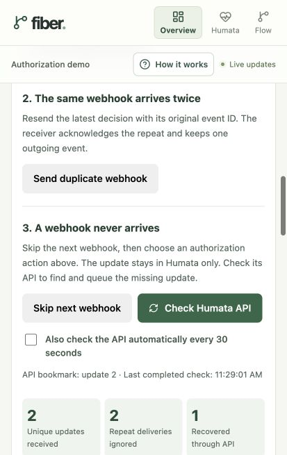

# Browser demo walkthrough

The browser demo adds two React/TypeScript interfaces to the existing integration. Authorization buttons save a Humata decision and trigger a signed HTTP webhook. Our receiver saves the event with a pending outbox entry; a background publisher sends it to the Event Hubs emulator over Kafka. The existing Kafka receiver saves it into PostgreSQL event history. Flow reads that history when you explicitly request a pull.

## Start the demo

For a fresh checkout, run `make setup`, review the emulator license linked in `.env.example`, and set `ACCEPT_EULA=Y` in `.env`.

```sh
make web
```

Open the overview at [http://localhost:58080](http://localhost:58080). It shows Humata and Flow together. You can also open [Humata](http://localhost:58080/humata) and [Flow](http://localhost:58080/flow) in separate windows. They share the active scenario and update automatically.

The port can be changed with `WEB_HOST_PORT` in `.env`. `make web` prints the configured address.

## Choose an encounter or add practice data

The **Encounter** selector switches both apps to the same encounter. Each encounter keeps its own authorization history, last Flow load, and evaluation. **New encounter** starts a fresh case without deleting earlier work.

**Add sample encounters** adds 48 fictional encounters with 126 authorization updates. The examples include six procedures, four payers, provider information, claim amounts, service dates, and original denial dates. **Encounter details** reveals the extra context without filling the main workspace with fields.

The sample authorization histories pass through the existing producer, Event Hubs Kafka endpoint, and receiver. Adding the cases does not insert received events directly into history or automatically load anything into Flow. Repeating the action reuses the existing sample cases and resumes an interrupted delivery without duplicating decisions. Your currently selected encounter is preserved.

The first eight cases illustrate these outcomes; the remaining cases repeat the patterns with different encounter details:

| Case | Authorization history |
| --- | --- |
| Demo patient 001 | Required → attempt → submitted → approved, with coverage for the service date |
| Demo patient 002 | Authorization is required; approval is still needed |
| Demo patient 003 | Request submitted, awaiting a decision |
| Demo patient 004 | Request denied |
| Demo patient 005 | Approved, but the approval dates do not cover the service date |
| Demo patient 006 | Authorization not required |
| Demo patient 007 | An authorization attempt has started |
| Demo patient 008 | A later denial supersedes an earlier approval |

The first 24 cases retain the original missing-authorization denial. Cases 025–048 add paid claims, pending claims, and denials for service coverage or eligibility. They keep claim status independent of authorization status. For example, patient 026 is paid, 027 is pending, 028 has a service-coverage denial, and 029 has an eligibility denial. A covered authorization approval alone does not resolve a denial about a different issue. Patient aliases, payers, providers, identifiers, and amounts are fictional; procedure IDs are demo identifiers rather than billing codes. Older encounters retain their existing data and may have no additional descriptive details.

## Read the three separate facts

**Original claim denial** describes a claim that was already denied. Paid or pending examples instead say **Original claim status**. Updating authorization does not change a claim’s status or original denial reason. Paid and pending claims have no denial-evaluation action; you can still load their authorization histories.

**Humata’s latest status** shows the latest decision at the source, including its update number and decision time. **Loaded in Flow** shows the decision Flow explicitly loaded, with its update number and load time. They can differ. For example, Humata can show **Approved** while Flow still shows **Required — approval still needed** until you load again.

## 1. Choose an action in Humata

The encounter shows all six authorization actions together:

| Button | What it represents |
| --- | --- |
| Require authorization | This visit needs prior authorization. |
| No authorization needed | This visit does not need prior authorization. |
| Start authorization | An attempt to obtain authorization has begun. |
| Submit authorization request | The request has been submitted for a decision. |
| Approve authorization | Authorization has been granted. |
| Deny authorization | Authorization has not been granted. |

These are simulated business actions. Each click creates and shares a real event through the local integration; it does not contact a payer. You can choose any action without following a required sequence.

For a first run, choose **Approve authorization**. The sample authorization number and dates are already filled in. **Approval number & dates** lets you edit them. The scenario’s service date is October 15, 2026, so the default approval covers the service date regardless of today’s date.

**New encounter** creates a fresh encounter in both apps and keeps earlier history. Open browser tabs share the active scenario.

## 2. See what happened

A message under the action buttons names the decision you chose. It first shows that the update is being saved or shared, then confirms when it has reached shared history.

**Shared successfully** means the separate receiver has saved the event in PostgreSQL. It does not mean Flow has loaded it yet. If delivery is unconfirmed, **Check delivery** opens the event details so you can inspect or retry it.

## 3. Load the update into Flow

Click **Load latest update** in Flow. The comparison shows Humata’s latest status alongside the decision Flow has loaded. The loaded approval number and coverage dates appear below it. **Continue in Flow**, when shown under Humata, takes you to these controls without loading anything automatically.

The button reads saved PostgreSQL history and stores a snapshot for this encounter. PostgreSQL stands in for the proposed R1DP/Databricks history. This manual load represents Flow’s daily pull, without making you wait a day.

**View evidence for this decision** opens the synthetic source record referenced by the loaded event. New records match that decision and any custom approval details. Older events retain their original references and clearly label the reused legacy fixture. No real Humata document is fetched.

## 4. Evaluate the denial

For a denied claim, click **Evaluate denial**. Flow uses the information you last loaded. Paid and pending claims have no denial to evaluate. Denials about coverage or eligibility remain manual review even when an authorization approval exists, and the explanation identifies that difference.

With the default approval, the result is **Possible dispute — human review needed**. Open **Why this result?** to see the encounter match, approval status, date coverage, and evidence-reference checks. The claim remains denied. A person must review the source evidence and decide what to do; the demo does not submit an appeal.

## 5. Try a different outcome

Click **Deny authorization** in Humata after loading and evaluating an approval.

The new decision is shared, but Flow keeps its earlier loaded approval. A message says that a new update is available, and the earlier evaluation is labelled as using older information.

Click **Load latest update**, then **Evaluate denial**. Flow now uses the denial and recommends **Manual review needed**. Evaluating before loading again continues to use the earlier approval.

You can also approve with dates outside October 15, then load and evaluate. An approval whose dates do not cover the service date still needs manual review.

## Details when you want them

The main screen keeps the encounter and its actions in focus. Supporting information stays collapsed until you open it:

- **Event history & delivery details** in Humata shows publications, acceptance, persistence, receipts, JSON, and safe retry/replay controls.
- **Received event history** in Flow shows updates the receiver has saved. This feed updates automatically, independently of Flow’s loaded snapshot.
- **How the connection works** below the apps explains the transport and displays progress for the latest update.
- **How it works** at the top opens a short walkthrough.

## Delivery lab: failures, duplicates, and API recovery

Run `make web`, refresh the browser, choose **New encounter**, and expand **Delivery lab** under the Humata authorization card. Controls apply only to the selected encounter and survive application restarts. The activity list and counters show actual persisted results. API recovery is manual by default so a missed delivery stays visible while you inspect it.

### A failed webhook delivery

1. Click **Stop webhook receiver**.
2. Choose **Approve authorization**, or another main authorization action.
3. Humata keeps the decision. Its signed webhook gets HTTP 503, and no inbox or outgoing event is created. Flow retains its earlier loaded data.
4. Click **Restore receiver & retry**. The next worker tick retries failed deliveries immediately, using their original event IDs and revisions.
5. Wait for the Kafka receiver to save the update, then choose **Load latest update** in Flow.

While delivery is failing, the simulated vendor retries with increasing delays starting at 15 seconds and capped at 60 seconds. Its retry jobs survive restarts. The control only makes the webhook endpoint unavailable; PostgreSQL, the API recovery path, and Event Hubs remain available.

### A duplicate webhook

1. Save an authorization decision and let it reach our receiver.
2. Click **Send duplicate webhook**, repeatedly if desired.
3. **Repeat deliveries ignored** increases. **Unique updates received** stays unchanged, and no additional outgoing event is created.

The sender performs another real HTTP request with the original payload and event ID. A PostgreSQL uniqueness rule handles simultaneous copies safely. If the publisher itself repeats a Kafka message after losing an acknowledgment, the Kafka history receiver independently recognizes that event ID.

### A missed update recovered through the API

1. Click **Skip next webhook**. The notice confirms that the experiment is armed.
2. Choose an authorization action. This consumes the flag: the source decision is saved, but no webhook is sent or scheduled for retry. The latest status in Humata changes while shared history and Flow stay behind.
3. Click **Check Humata API**.
4. The recovery job makes authenticated HTTP requests to the simulated Humata change-history API. It finds changes after its saved bookmark, ignores updates already accepted through webhooks, and queues missing ones through the same receiving transaction.
5. **Recovered through API** increases. After the normal Kafka path saves the update, choose **Load latest update** in Flow.
6. Check the API again. With no newer changes, no extra event is created.

Enable **Also check the API automatically every 30 seconds** to see scheduled recovery. Source history is paginated and bounded at the newest revision observed when the scan starts; newer changes wait for the next check. The bookmark is per encounter. A page’s inbox entries, outgoing events, and next bookmark commit together. If a page fails, that page is retried; earlier committed pages remain saved. A failed check does not update the time of the last completed catch-up.



### Other failure controls

Under **More failure controls**, enable **Pause publishing to Event Hubs**, then save a decision. The webhook succeeds because its message is durably saved with an outbox row. Sharing waits until you clear the checkbox. This pauses our worker rather than stopping the broker. Actual broker failures also leave pending rows, generate error logs, and retry with increasing delays.

Enable **Make the Humata API unavailable**, then run an API check. The check fails and keeps its bookmark. Clear the checkbox and check again to resume recovery. These deliberate HTTP failures are shown in the activity list without being logged as unexpected server errors; real database and connection failures remain errors.

Recovering an older update preserves it in history without replacing a newer authorization status. Flow continues using its explicit loaded snapshot until you load again.

### What this simulation assumes

The mock vendor supports stable event IDs, increasing per-encounter revisions, and a complete retained change history. A real vendor might provide only current-state records, shorter retention, different pagination, or different retry limits; those contracts must be confirmed. A current-state API cannot reconstruct every missed intermediate transition.

Source state and integration tables share the local database and Node server for convenience. Webhooks and recovery nevertheless cross actual HTTP endpoints, with independent database transactions. The integration receiver resolves identity from its crosswalk and does not query Humata’s source tables. Only the simulated vendor API reads source history. This is an executable learning example, not a production webhook security or operational specification. No external Humata service is called.

Kafka is the protocol used by the Node producer and receiver to communicate with Microsoft’s local Event Hubs emulator. There is no separate Kafka server. Only the receiver saves received events in PostgreSQL; Flow reads them from that database when you load an update. Replaying an older event does not replace a newer source decision.

## What runs underneath

| Piece | Code |
| --- | --- |
| React/TypeScript screens | [web/src/main.tsx](../web/src/main.tsx) |
| Delivery feedback, optional progress, and evaluation | [web/src/LearningUI.tsx](../web/src/LearningUI.tsx), [web/src/learning.ts](../web/src/learning.ts) |
| Responsive styles | [web/src/styles.css](../web/src/styles.css), [web/src/clarity.css](../web/src/clarity.css) |
| Decision-specific source evidence | [src/demo-evidence.js](../src/demo-evidence.js) |
| HTTP API and live updates | [src/web-server.js](../src/web-server.js) |
| Scenario, publication, pull, and review operations | [src/demo-service.js](../src/demo-service.js) |
| Webhook receiver, durable outbox worker, source API, and recovery | [src/integration.js](../src/integration.js) |
| Delivery lab controls | [web/src/DeliveryLab.tsx](../web/src/DeliveryLab.tsx) |
| Fictional encounter catalog | [src/sample-encounters.js](../src/sample-encounters.js) |
| Kafka producer and receiver | [src/transport.js](../src/transport.js) |
| Database tables | [db/schema.sql](../db/schema.sql) |

The Node API serves the built React files and sends browser updates through Server-Sent Events. It checks PostgreSQL about once a second and broadcasts current state. Event Hubs availability is checked periodically; receiver availability comes from broker heartbeat instrumentation.

The source simulator records immutable decisions and delivery metadata in `ui_publications`. Vendor retries are tracked in `integration_webhooks`; our receiver commits `integration_inbox` and `integration_outbox` together. `integration_state` stores controls and recovery bookmarks, while `integration_activity` records the teaching timeline. None of those operations insert a received event into `events`; only the Kafka receiver does that. `ui_pulls` stores Flow snapshots and `ui_reviews` stores their review results. These browser scenarios are separate from the CLI's `demo_scenarios` and `flow_batches` fixtures. Older decisions made before the webhook extension retain their original direct-publication history.

## Tests and development

```sh
make test             # Node, PostgreSQL, HTTP, and snapshot behavior
make test-recovery    # Webhook/outbox failure cases and API catch-up
make test-acceptance  # Real Kafka acceptance exercise
```

The suite checks that acknowledgment alone does not create received history, new events cannot silently change a loaded snapshot, guidance tracks the latest update, retries preserve event IDs, evidence matches its original reference, concurrent actions use distinct revisions, and new scenarios remain isolated.

For frontend development with Node.js 24+ installed:

```sh
make web
npm ci
npm run dev:web
```

Vite serves the interface on port 5173 and proxies API requests to the running Docker web service. Set `DEMO_API_URL` when using a different API address. `npm run build:web` checks TypeScript and builds the frontend. Changes to server code or the Docker-served interface require `make web` to rebuild and restart the affected services.

## Stop or reset

`make down` stops the demo and preserves PostgreSQL data, including the browser scenario and snapshots. `make web` restores it later.

Use **New encounter** for an ordinary fresh presentation. `make reset` deletes the demo's PostgreSQL volume and stops its containers; use that only when you intend to clear all saved demo data.
